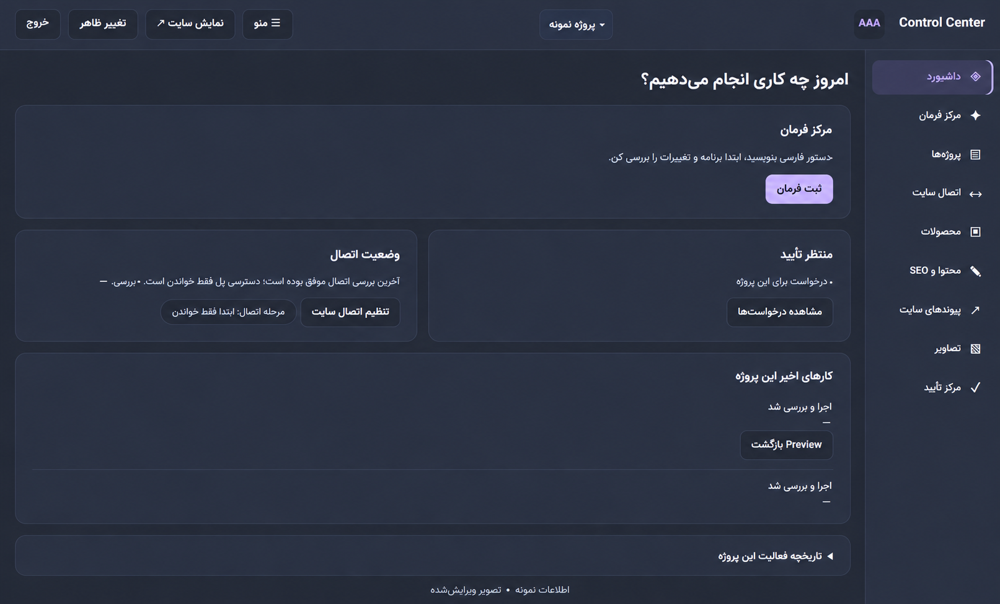

# AAA Control Center
### WordPress & WooCommerce Management Dashboard

A standalone web dashboard developed by AAA Software Studio to manage routine WordPress and WooCommerce tasks across multiple site projects.

Originally built for personal use, the project focuses on product editing, content drafts, and URL slug management through a central interface.

**Status:** In development · Personal, multi-project tool  
**Last reported version:** v0.10.3  
**Repository purpose:** Product showcase and documentation

## Dashboard Preview

*AI-edited portfolio preview based on the application interface. Project details and timestamps have been replaced or removed for privacy. This image illustrates the interface, not verified execution of every visible feature.*

## Current Scope

- Switch between configured site projects.
- View and edit WooCommerce product fields, including pricing and stock.
- Create and edit WordPress content drafts.
- View and update supported content slugs.
- Preview proposed changes and request confirmation before supported write operations.

Implementation and verification coverage vary by module. Previous evidence includes draft creation and a draft slug update; the full application has not undergone a fresh source review or comprehensive security assessment.

## Technology

PHP, JavaScript, HTML/CSS, and MySQL.

WordPress connections use the REST API with Application Passwords. WooCommerce connections use its REST API credentials.

## Development Boundaries

The dashboard currently serves a personal, multi-project workflow. Secure multi-user operation has not been established.

AI-assisted workflows are planned, starting with a provider settings interface for a user-supplied Gemini API key. This interface and its proposed content assistance features are not yet implemented or verified.

Installation, updates, credential protection, compatibility, and dependency licensing require further review before wider distribution.

## Source & Privacy

Application source code and installable packages are not included in this showcase.

Public demonstrations must use fictional data in an isolated environment. Simulated interactions will be explicitly labeled. Production credentials, client information, and private site content are excluded.

An edited dashboard preview is included above. A public interactive demo is not currently available.

## About the Studio

Built as part of [AAA Software Studio](https://github.com/aaa-software-studio), documenting practical work in WordPress tooling, SEO workflows, and automation.

